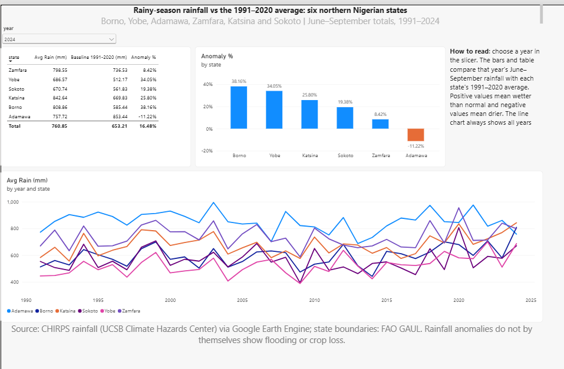

# Rainy-Season Rainfall Anomalies in Northern Nigeria

An interactive Power BI dashboard, built on rainfall data processed in
Google Earth Engine, comparing June to September rainfall in six northern
Nigerian states with their 1991-2020 long-term averages.



## Why this project

Rainfall variability affects farming, food security and flood risk across
northern Nigeria. Humanitarian assessments often need quick climate context
alongside household survey data. This project shows a reproducible way to
produce that context: from satellite rainfall estimates to a dashboard that
a non-specialist can read.

## Question

How did rainfall in the 2024 rainy season compare with the long-term average
in Borno, Yobe, Adamawa, Zamfara, Katsina and Sokoto, and how has seasonal
rainfall varied since 1991?

## Key findings

- **2024 was wetter than normal in five of the six states.** Rainfall was
  above the 1991-2020 average in Borno (+38.2%), Yobe (+34.1%), Katsina
  (+25.8%), Sokoto (+19.4%) and Zamfara (+8.4%). Adamawa was the exception
  at -11.2%. The 2024 totals for Borno (809 mm) and Katsina (843 mm) were the
  highest in their 1991-2024 series.
- **Rainfall moves together within regions.** Year-to-year
  rainfall in Borno and Yobe is closely correlated (r = 0.89), as is rainfall
  in Sokoto, Zamfara and Katsina (r = 0.78 to 0.87). Adamawa, the wettest
  state (average 853 mm against 512 mm in Yobe), is largely independent of the
  others (r = 0.07 to 0.30).
- **Year-to-year variability differs by state.** Measured as the coefficient
  of variation (standard deviation as a percentage of the average,
  1991-2020), it was highest in Sokoto (15.8%) and Yobe (12.4%) and lowest in
  Adamawa (8.5%), the wettest state.
- **Across the six states, 2009 was the driest season and 2020 the wettest.**
  The average of the six states was 541 mm in 2009 and 784 mm in 2020. Any
  long-term trend is weak: the six-state average rose by about 14 mm per decade
  (r = 0.23), which is not strong evidence of change.

## Data

| Dataset | Source | Use |
|---|---|---|
| CHIRPS Daily (`UCSB-CHG/CHIRPS/DAILY`) | Climate Hazards Center, UC Santa Barbara | Daily rainfall estimates (mm/day), about 5.5 km resolution, public domain |
| FAO GAUL 2015, level 1 (`FAO/GAUL/2015/level1`) | FAO | State boundaries |

## Method

### 1. Earth Engine (`gee/rainfall_by_state.js`)

1. Select the six states from the GAUL boundaries.
2. For each year from 1991 to 2024, sum daily CHIRPS rainfall from
   1 June to 30 September to get the seasonal total in millimetres.
3. Average each seasonal total over every state (5,566 m scale, matching the
   CHIRPS pixel size).
4. Export the result as a CSV with one row per state and year
   (6 states x 34 years = 204 rows).

### 2. Power BI (`powerbi/rainfall_anomaly_dashboard.pbix`)

Three DAX measures drive the dashboard:

```
Avg Rain (mm) = AVERAGE(rainfall[rain_mm])

Baseline 1991-2020 (mm) =
CALCULATE(
    AVERAGE(rainfall[rain_mm]),
    FILTER(ALL(rainfall[year]), rainfall[year] >= 1991 && rainfall[year] <= 2020)
)

Anomaly % =
DIVIDE([Avg Rain (mm)] - [Baseline 1991-2020 (mm)], [Baseline 1991-2020 (mm)])
```

- The **baseline** is each state's average seasonal rainfall over 1991-2020.
  It ignores the year slicer, so it stays fixed while the selected year
  changes.
- The **anomaly** is how far the selected year is above or below that
  baseline, as a percentage of the baseline.

## Dashboard guide

| Element | What it shows |
|---|---|
| Year slicer | Selects the year to compare (default 2024) |
| Column chart | Rainfall anomaly (%) for each state in the selected year |
| Table | Selected-year rainfall, baseline and anomaly by state |
| Line chart | Seasonal rainfall for every year, one line per state |

## Limitations

- **Rainfall is not impact.** An anomaly shows where conditions were unusual,
  not whether floods, crop losses or displacement occurred.
- **Satellite estimates.** CHIRPS combines satellite and station data, and
  its accuracy varies, especially where few ground stations exist.
- **State averages hide local variation.** Large states contain very
  different local rainfall patterns.
- **One season only.** Only June to September is analysed, so early or late
  rains outside that window are not captured.
- **Fixed baseline.** The 1991-2020 baseline smooths over any longer-term
  trend within that period.

## Possible extensions

- Add monthly rainfall to show when in the season anomalies occurred.
- Use local government area boundaries instead of state boundaries.
- Add a vegetation index such as NDVI to explore the link between rainfall
  and crop conditions.
- Join the rainfall anomalies to household survey data on food security.

## Repository structure

```
gee/        Earth Engine script
data/       Exported CSV (204 rows)
powerbi/    Power BI report file
images/     Dashboard screenshot and study-area map
```

## How to reproduce

1. Open the [Earth Engine Code Editor](https://code.earthengine.google.com)
   and paste in `gee/rainfall_by_state.js`.
2. Run the script. Check that the console shows 6 states and 204 rows.
3. In the **Tasks** tab, run the export and download the CSV from Google
   Drive into `data/`.
4. Open `powerbi/rainfall_anomaly_dashboard.pbix` in Power BI Desktop and
   point the data source at your CSV (*Home > Transform data > Data source
   settings*).

## Tools

Google Earth Engine (JavaScript API), Power BI Desktop (DAX), CHIRPS, FAO GAUL

## Author

George Anya, Abuja, Nigeria
[LinkedIn](https://www.linkedin.com/in/georgeulah) |
[GitHub](https://github.com/George-Anya)

## Data citation

Funk, C., Peterson, P., Landsfeld, M. et al. (2015). The climate hazards
infrared precipitation with stations: a new environmental record for
monitoring extremes. *Scientific Data* 2, 150066.
https://doi.org/10.1038/sdata.2015.66

FAO GAUL: Global Administrative Unit Layers (2015). Please check FAO's terms
of use for the boundary data.
